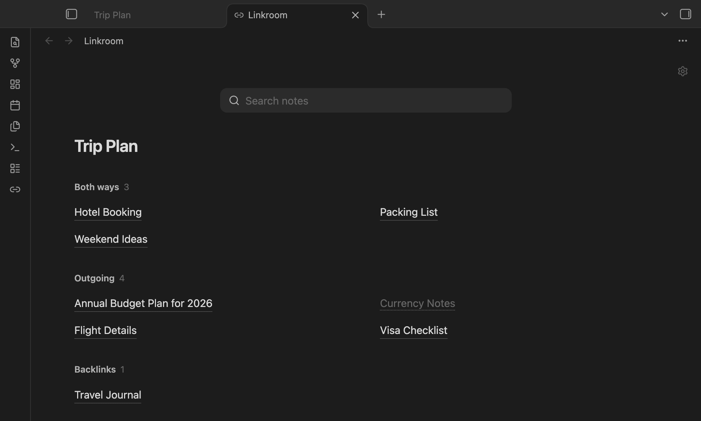
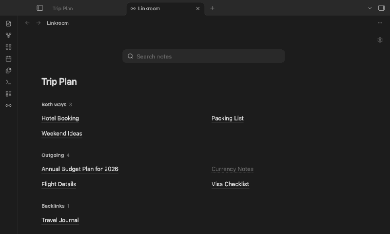

# Linkroom

See every note linked to and from the note you're reading, on a calm, full-page grid.



- **Three groups:** Both ways, Outgoing and Backlinks. Each note appears once.
- **Search any note:** works like the quick switcher (Cmd/Ctrl+O). Pick a note and the page switches to its links.
- **Follows you:** the page updates as you move between notes.
- **Your style:** three link styles (Hairline, Sky link, Soft tile), columns, sort, folders and aliases.
- **Read-only:** no edits to your notes, no network, no tracking.



## Use

Click the link icon in the ribbon, or run **Open linked notes** from the command palette.

| Action | Result |
|---|---|
| Click | Open the note; Linkroom stays open |
| Cmd/Ctrl-click | Open in a new tab |
| Right-click / long-press | More options |
| `/` or Cmd/Ctrl+F | Focus search |

The gear in the top-right corner holds quick toggles. Everything else is under **Settings → Linkroom**.

## Install

Until Linkroom is in the community plugin directory, download `main.js`, `manifest.json` and `styles.css` from the [latest release](../../releases/latest) into `<vault>/.obsidian/plugins/linkroom/`, then enable it under **Settings → Community plugins**.

Works on desktop and mobile. Mobile has been checked in emulation only so far.

## Development

```sh
npm install && npm run build && npm run lint && npm test
```

## Licence

MIT © 2026 Anthirayas
